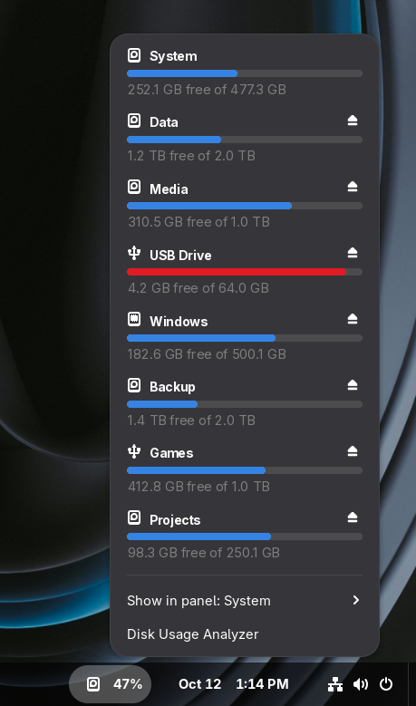
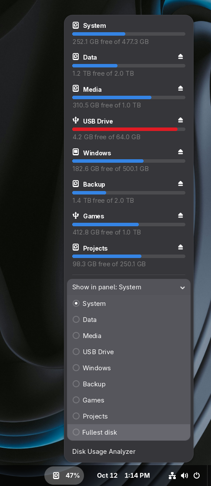

# Disk Usage Indicator

A GNOME Shell extension that shows disk usage in the top panel, with Windows Explorer–style usage bars.

<p align="center">
  
  &nbsp;
  
</p>

## Features

- **Usage in the panel**: shows the selected disk's usage percentage next to a drive icon. It turns red above 90%.
- **Every disk in the menu**: clicking the icon lists the system disk (`/`) and every mounted drive (USB sticks, external drives, NTFS partitions, etc.), the same set Nautilus shows in its sidebar. Each one has a usage bar and the free space ("120 GB free of 500 GB").
- **Open in the file manager**: clicking a disk opens it in Nautilus.
- **Eject**: removable drives get an eject/unmount button.
- **Choose the panel disk**: the *Show in panel* submenu picks which disk appears in the panel, or *Fullest disk* to always show the fullest one. If the chosen disk is unplugged, the panel falls back to the system disk.
- **Disk Usage Analyzer**: a shortcut to Baobab, if installed.
- **Automatic refresh**: usage is refreshed every 60 seconds, when the menu opens, and whenever a drive is plugged in or removed.

## Requirements

- GNOME Shell 48, 49 or 50
- `glib-compile-schemas` (package `glib2` / `libglib2.0-bin`), to compile the settings schema
- `make` (optional, makes installing easier)

## Installation

### From source

```bash
git clone https://github.com/alexbaixista/disk-usage-indicator.git
cd disk-usage-indicator
make install
```

`make install` compiles the settings schema and symlinks the repository to `~/.local/share/gnome-shell/extensions/disk-usage-indicator@alex`, so code changes take effect the next time the shell restarts.

Then log out and back in (on Wayland there's no other way to restart the shell) and enable the extension:

```bash
gnome-extensions enable disk-usage-indicator@alex
```

You can also enable it from the **Extensions** app or **Extension Manager**.

### From a `.zip` package

```bash
make pack
gnome-extensions install --force disk-usage-indicator@alex.shell-extension.zip
```

Log out and back in, then enable the extension as shown above.

## Uninstalling

```bash
make uninstall
```

## Configuration

The only setting is which disk is shown in the panel. Change it from the extension's own menu (*Show in panel*) or from the command line:

```bash
# Mount point of a specific disk
gsettings --schemadir schemas set org.gnome.shell.extensions.disk-usage-indicator panel-disk '/run/media/user/MyDrive'

# Always the fullest disk
gsettings --schemadir schemas set org.gnome.shell.extensions.disk-usage-indicator panel-disk 'fullest'

# Back to the default (system disk)
gsettings --schemadir schemas reset org.gnome.shell.extensions.disk-usage-indicator panel-disk
```

## Development

| File | Description |
| --- | --- |
| `extension.js` | Extension code (panel indicator, menu, and reading disks through GIO) |
| `stylesheet.css` | Styles for the bars, labels and the critical state |
| `schemas/` | GSettings schema with the `panel-disk` key |
| `metadata.json` | Extension metadata (UUID, supported GNOME Shell versions) |
| `Makefile` | `install`, `uninstall` and `pack` targets |

To follow the extension's errors and log output:

```bash
journalctl -f -o cat /usr/bin/gnome-shell
```

To test without logging out, run a nested shell (GNOME 49+):

```bash
dbus-run-session gnome-shell --devkit --wayland
```

On GNOME 48, use `dbus-run-session gnome-shell --nested --wayland`.

## Contributing

Issues and pull requests are welcome at [github.com/alexbaixista/disk-usage-indicator](https://github.com/alexbaixista/disk-usage-indicator).

## License

Licensed under the [GNU General Public License v2.0 or later](LICENSE).
